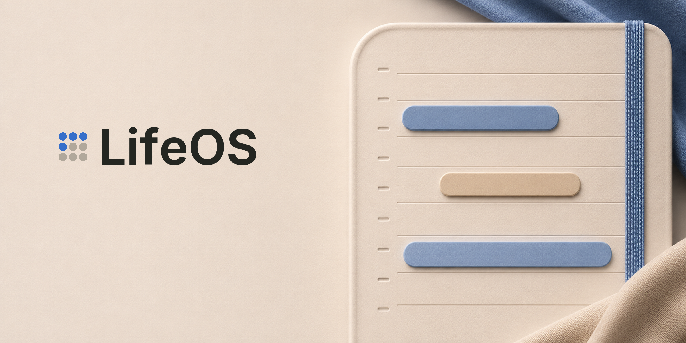
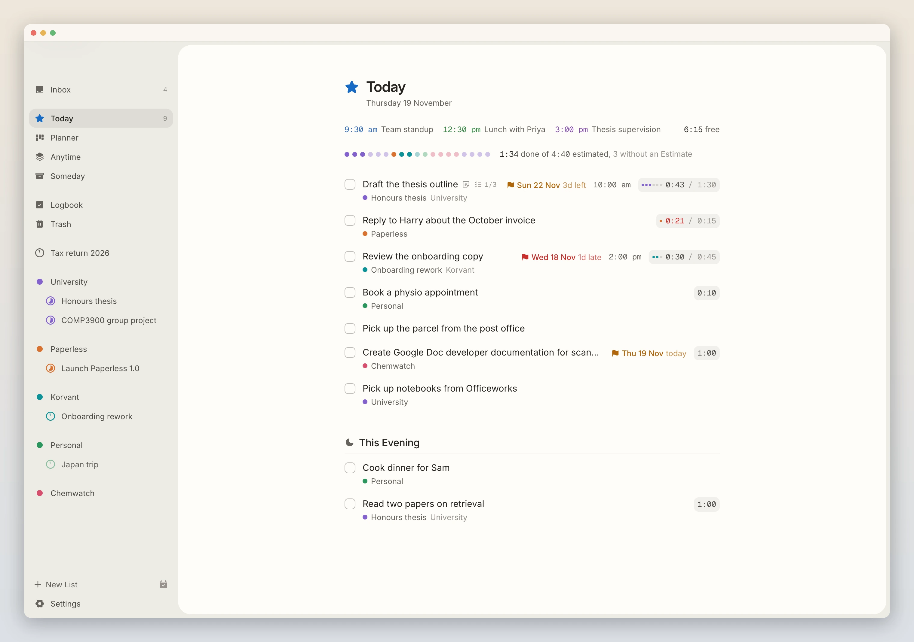
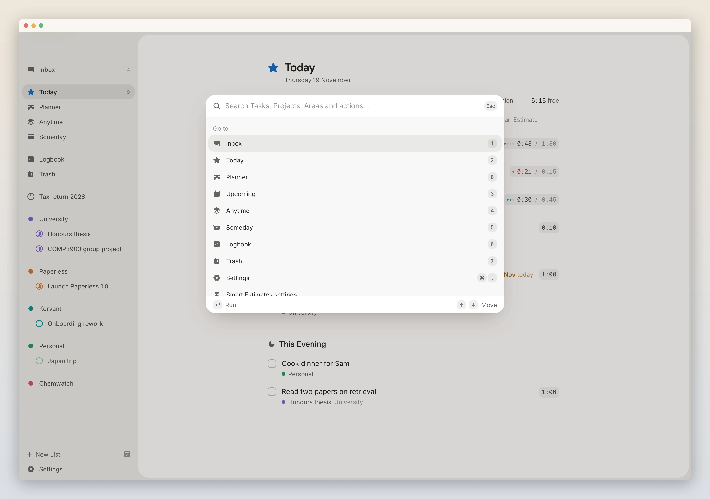
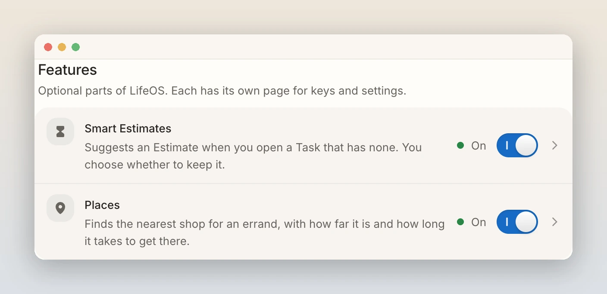

<picture>
  <source media="(prefers-color-scheme: dark)" srcset="docs/readme/hero-dark.png">
  <source media="(prefers-color-scheme: light)" srcset="docs/readme/hero-light.png">
  
</picture>

# LifeOS

A personal planner for tasks, timeboxing and focus on web, Mac and iPhone.

I built LifeOS to take over from Things 3. I wanted the same calm place to keep my tasks, with enough room to see what fits around my calendar. LifeOS is now where I plan my day. The [one-way Things import](docs/leaving-things.md) covers the handover.

## Today and capture

See today's Tasks and keep evening plans together. Press `Q` to send a thought to the Inbox. Typing `tomorrow 30m` gives it a date and an Estimate. Use `Cmd+K` to find a Task, Project or Area and act on it without leaving the keyboard.

<picture>
  <source media="(prefers-color-scheme: dark)" srcset="docs/readme/screens/today-dark.webp">
  
</picture>

<details>
<summary>Quick capture and the command bar</summary>

<picture>
  <source media="(prefers-color-scheme: dark)" srcset="docs/readme/screens/capture-dark.webp">
  
</picture>

<picture>
  <source media="(prefers-color-scheme: dark)" srcset="docs/readme/screens/command-bar-dark.webp">
  
</picture>

</details>

## Planner and Timebox

Set a daily Goal in Days. The meter shows planned work against the Goal and the time available. Open it for a breakdown by Area.

<picture>
  <source media="(prefers-color-scheme: dark)" srcset="docs/readme/screens/days-dark.webp">
  
</picture>

In Timebox, place Work Blocks beside commitments imported from Apple Calendar and the Sleep Window from Oura. Spread previews where the day's Tasks could fit. Confirm to place the blocks together.

<picture>
  <source media="(prefers-color-scheme: dark)" srcset="docs/readme/screens/timebox-dark.webp">
  
</picture>

## Smart Estimates and Places

Smart Estimates uses OpenAI's Decisions API to suggest durations for a Task. Pick a guess to set its Estimate. Places can find the nearest branch for an errand, show the trip on a map and add the return journey to the Estimate.

<picture>
  <source media="(prefers-color-scheme: dark)" srcset="docs/readme/screens/task-card-dark.webp">
  
</picture>

## Repeats and Templates

Set a Task to repeat on a schedule, such as every weekday or the first Thursday of the month, or a set time after you finish it. Upcoming shows each rule's next occurrence, where you can skip it or stop the rule. Save any Task as a Template and start new Tasks from it, with its Estimate, Labels and Checklist Items.

## Focus and undo

Start a Focus Session from a Task and choose a stopwatch or Pomodoro. Most planner changes can be undone with `Cmd+Z` or from Activity. One undo can take back a whole Spread.

## Settings and the Mac app

Features work like optional plugins. Smart Estimates and Places each have their own switch and settings page.

<picture>
  <source media="(prefers-color-scheme: dark)" srcset="docs/readme/screens/settings-dark.webp">
  
</picture>

The Mac app guides you through permissions on first run. Open Quick Capture from another app with `Control+Shift+Space`, or use the menu bar.

<picture>
  <source media="(prefers-color-scheme: dark)" srcset="docs/readme/screens/welcome-dark.webp">
  
</picture>

## Architecture

Convex Core owns the data, Activity and Jobs. Waku runs the web app, Tauri wraps it for Mac, and Expo runs the iPhone app. A small Cloudflare relay syncs notes between devices. The Core also exposes a remote MCP connector. [Read the architecture](docs/architecture.md).

## Run it

[devenv](https://devenv.sh) gives every tool the repo needs: Node 24, pnpm (the exact `packageManager` version), Rust 1.95 with Clippy and rustfmt, CocoaPods, uv and gh. They live in the Nix store and only appear inside the repo. Xcode stays the system one: it gives every compiler, linker and SDK, for the Mac app and the iPhone app alike.

1. Install devenv (with nix-darwin, add `pkgs.devenv` to `environment.systemPackages`) and Xcode.
2. In the repo, run `direnv allow` once. Each `cd` into the repo then loads the tools. Without direnv, use `devenv shell`.
3. Run `doctor` to see which tool comes from where.

`devenv up` starts the web dev server on port 3000. `LIFEOS_WEB_PORT=3101 devenv up` moves it. Two more processes only start when named:

```sh
devenv up convex   # convex dev: pushes functions to the hosted dev deployment on every save
devenv up metro    # Expo dev server for the iPhone development build, port 8081 (LIFEOS_METRO_PORT)
```

`tauri dev` (`pnpm dev:desktop`) starts its own web dev server on port 3000, so stop `devenv up` first.

Without devenv, use Node 22.18 or later and pnpm 10. The Mac app also needs Rust and the macOS build tools.

```sh
pnpm install
pnpm dev:backend
```

Point `WAKU_PUBLIC_CONVEX_URL` and `EXPO_PUBLIC_CONVEX_URL` at the Convex URL in the respective app's environment. See [authentication setup](docs/auth.md) for owner access.

```sh
pnpm dev:web
pnpm dev:desktop
pnpm dev:mobile
```

Run `pnpm check` for lint, Clippy, type checks, tests and the web build. Set `LIFEOS_CONVEX_URL` and `WAKU_PUBLIC_CONVEX_URL` for the check in a fresh worktree.

### End-to-end swarm and performance profiles

`apps/e2e` is a Playwright Test harness (#89). It never touches the hosted deployment or the live Notes Relay: each run seeds its own throwaway local backend with `apps/web/scripts/local-backend.sh`, builds the web app against it into `apps/web/dist-e2e-<port>` and serves it with `waku start`.

```sh
pnpm e2e        # the swarm: every spec on every core, in parallel
pnpm e2e:perf   # the profiles: one worker, Chromium slowed 4x, then WebKit
```

The swarm runs eight projects (Chromium and WebKit, 1440 px and iPhone width, light and dark) with `fullyParallel` on half the cores (7 workers on a 14-core Mac), at low priority (`nice -n 15`) so the Mac stays responsive. The local backend and the web build are capped at 4 threads each. Raise the limit with `E2E_WORKERS=100% pnpm e2e` (or a number) and `E2E_BUILD_THREADS=8`. Each worker signs in with its own sessions (`scratch:signInMany`) and works on Tasks with unique names, so tests never collide. The specs cover the lists, Areas and Projects, Quick Capture, the Task card and each of its tools, the Planner (panes, tabs, a drag, the Timebox), the command bar, keyboard shortcuts, Notes and the mode switch, Settings and undo. `crawler.e2e.test.ts` visits every route, presses every visible button that is not destructive, tries the global shortcuts and runs axe. Every test fails on a console error, an uncaught exception, a failed request, an HTTP error or an error boundary. Known axe findings are skipped unless `E2E_AXE_STRICT=1`: faint text below 4.5:1 contrast (a design token), and `aria-hidden-focus` while a Radix menu or popover is open. Notes run without a relay, offline first.

Failures keep a trace and a screenshot, and the retry records a video. The HTML report is in `apps/e2e/out/report` (`pnpm --filter @lifeos/e2e report`), and `node apps/e2e/src/failures.ts apps/e2e/out/results.json` prints each failure in a line or two. `E2E_PROJECTS=chromium-desktop` picks projects, `E2E_KEEP=1` leaves the stack running after the run and `E2E_REUSE=1` reuses it (skip the 40 s of setup), and `pnpm --filter @lifeos/e2e e2e:stop` stops it. It is not part of `pnpm check`: a full swarm (360 tests) takes about 6 minutes on this Mac with 7 workers, plus 40 s to seed and build.

`pnpm e2e:perf` needs a quiet machine. It seeds 2,400 extra Tasks (`scratch:seedBulk`), builds with the React profiling build and runs serially. For each interaction it records the time from the input to the frame that shows the result, the slowest input-to-paint (Event Timing, the number INP is built from), long tasks and blocking time, dropped frames (requestAnimationFrame gaps over 25 ms), and React commits with their render time. The first switch to a screen is reported as cold. Chromium also writes a performance trace per interaction to `apps/e2e/out/perf/profiles/traces` (open it in the DevTools Performance panel). The medians go to `out/perf/profiles/summary.md` and `summary.json`, and a run fails when an interaction is more than 1.5 times slower than `apps/e2e/perf/baseline.json` (plus a small allowance). `E2E_PERF_UPDATE=1` saves a new baseline. `E2E_ENGINES`, `E2E_PERF_RUNS` and `E2E_THROTTLE` change the run.

## Deploy the web app

The web app is live at <https://lifeos.zephyrus.qzz.io>. Every page is static, so Cloudflare serves the Waku build (`apps/web/dist/public`) as a Worker with static assets only, on a Workers Custom Domain. `apps/web/wrangler.jsonc` holds the config. It turns off the `workers.dev` and preview URLs, so the custom domain is the only way in.

```sh
pnpm --filter @lifeos/web run deploy
```

The script builds with `WAKU_PUBLIC_CONVEX_URL` set to the hosted deployment, then runs `wrangler deploy`. Wrangler must be logged in to the Cloudflare account in the config (`npx wrangler@latest whoami`).

Sign-in works there because `convex/auth.ts` lists `https://lifeos.zephyrus.qzz.io` as an allowed return origin, next to `SITE_URL` (localhost) and the Convex site URL (the Mac and iPhone bounce routes). The GitHub callback does not change.

Cloudflare Access sits in front of the domain as a second gate. Its policy allows only the owner's email and signs in with GitHub. It is set up in the Zero Trust dashboard, not in this repo. Access only guards the web page: GitHub sends sign-in back through the Convex site URL, which Access does not cover, and the page then loads again behind the gate with its Access cookie.

## Deploy the Notes Relay

The Notes Relay is live at <https://lifeos-relay.zephyrus.qzz.io>. It is a Worker (`lifeos-relay`) with one Durable Object per note, on the same Cloudflare account and the Workers Free plan. `apps/relay/wrangler.jsonc` holds the config: SQLite-backed Durable Objects, a Workers Custom Domain, and no `workers.dev` or preview URLs. It sits outside Cloudflare Access, because it checks the Convex Auth token itself.

```sh
pnpm --filter @lifeos/relay test
pnpm --filter @lifeos/relay run deploy
```

The tests run the Worker in the Workers runtime (`@cloudflare/vitest-plugin`) against a local key server. The deploy needs Wrangler logged in to the account in the config. `GET /health` answers `ok` once it is up. The routes are `GET /notes/<noteId>` (the websocket, with the token offered as a second subprotocol after `lifeos-notes`), `POST /notes/<noteId>/sync` (catch-up, with `Authorization: Bearer`) and `DELETE /notes/<noteId>`.

## Docs

- [Domain glossary](CONTEXT.md)
- [Architecture](docs/architecture.md)
- [Data model](docs/data-model.md)
- [Design system](docs/design/system.md)
- [Authentication](docs/auth.md)
- [MCP connector](docs/mcp.md)
- [Leaving Things](docs/leaving-things.md)
