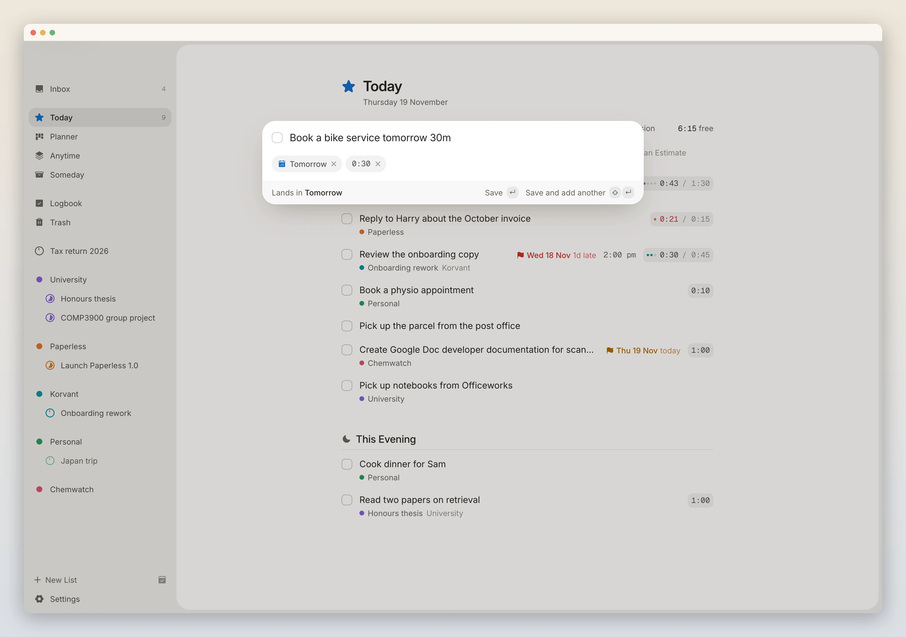
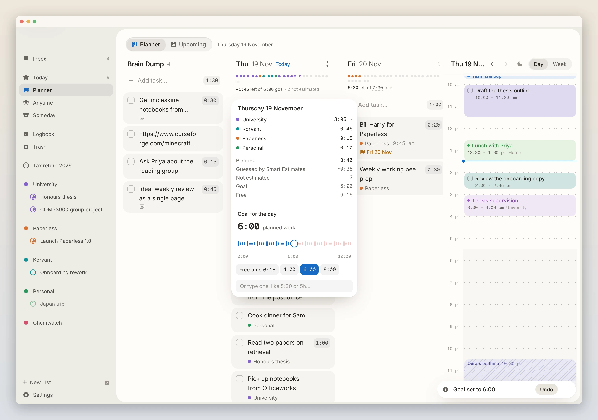
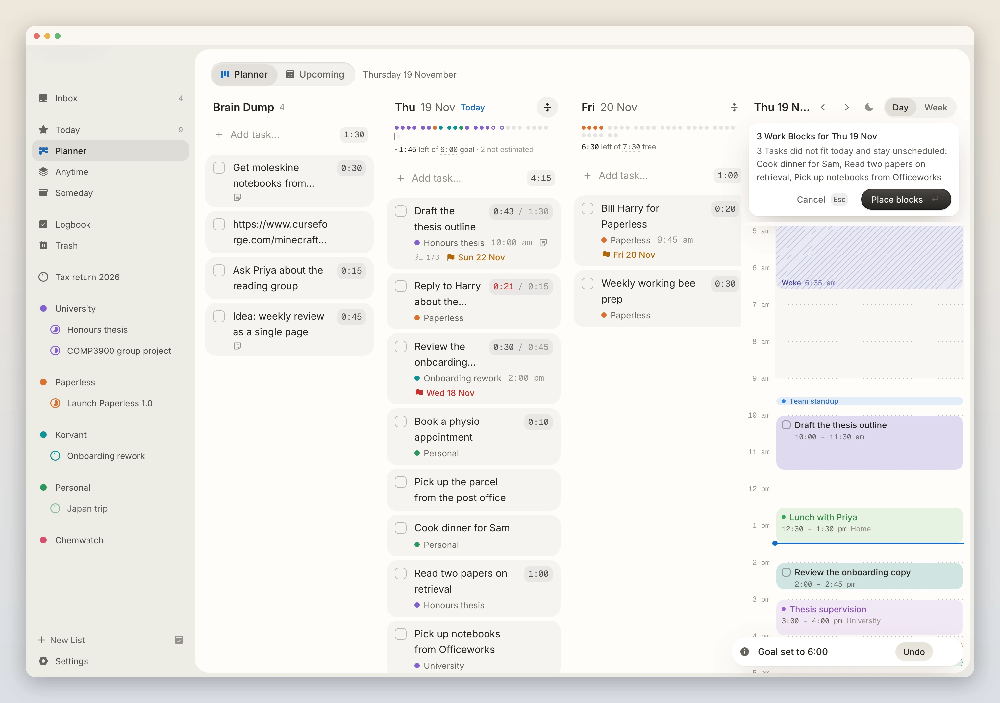
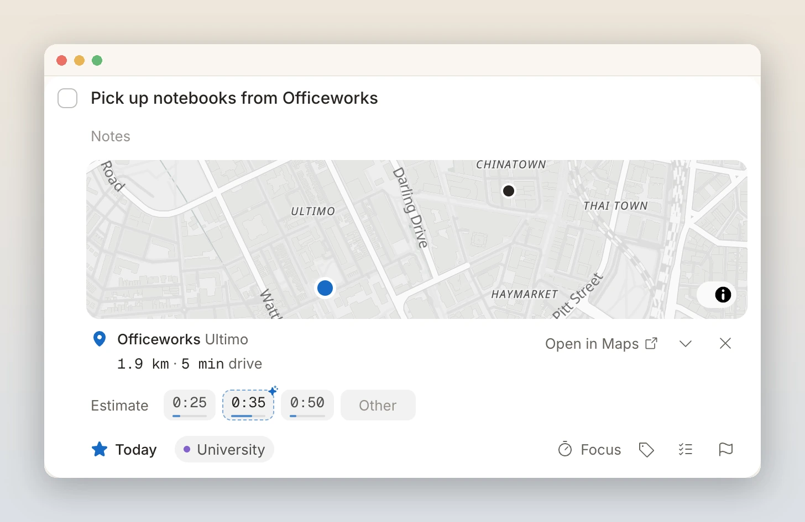
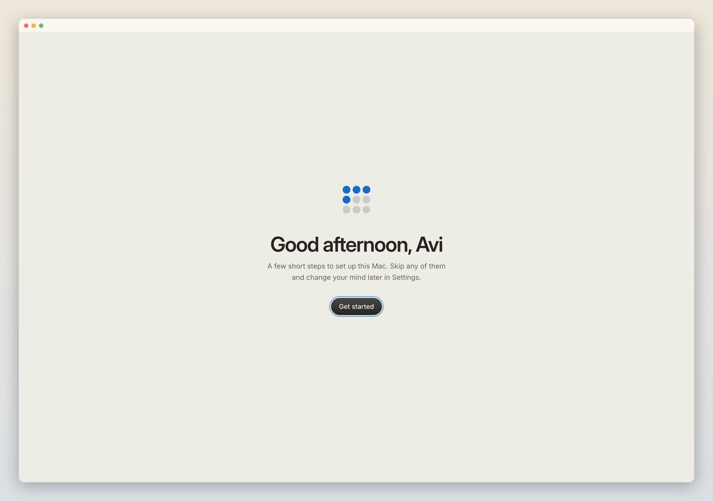

<picture>
  <source media="(prefers-color-scheme: dark)" srcset="docs/readme/hero-dark.png">
  <source media="(prefers-color-scheme: light)" srcset="docs/readme/hero-light.png">
  
</picture>

# LifeOS

A personal planner for tasks, timeboxing and focus on web, Mac and iPhone.

I built LifeOS to take over from Things 3. I wanted the same calm place to keep my tasks, with enough room to see what fits around my calendar. LifeOS is now where I plan my day. The [one-way Things import](docs/leaving-things.md) covers the handover.

## Today and capture

See today's Tasks and keep evening plans together. Press `Q` to send a thought to the Inbox. Typing `tomorrow 30m` gives it a date and an Estimate. Use `Cmd+K` to find a Task, Project or Area and act on it without leaving the keyboard.

<picture>
  <source media="(prefers-color-scheme: dark)" srcset="docs/readme/screens/today-dark.webp">
  
</picture>

<details>
<summary>Quick capture and the command bar</summary>

<picture>
  <source media="(prefers-color-scheme: dark)" srcset="docs/readme/screens/capture-dark.webp">
  
</picture>

<picture>
  <source media="(prefers-color-scheme: dark)" srcset="docs/readme/screens/command-bar-dark.webp">
  
</picture>

</details>

## Planner and Timebox

Set a daily Goal in Days. The meter shows planned work against the Goal and the time available. Open it for a breakdown by Area.

<picture>
  <source media="(prefers-color-scheme: dark)" srcset="docs/readme/screens/days-dark.webp">
  
</picture>

In Timebox, place Work Blocks beside commitments imported from Apple Calendar and the Sleep Window from Oura. Spread previews where the day's Tasks could fit. Confirm to place the blocks together.

<picture>
  <source media="(prefers-color-scheme: dark)" srcset="docs/readme/screens/timebox-dark.webp">
  
</picture>

## Smart Estimates and Places

Smart Estimates uses OpenAI's Decisions API to suggest durations for a Task. Pick a guess to set its Estimate. Places can find the nearest branch for an errand, show the trip on a map and add the return journey to the Estimate.

<picture>
  <source media="(prefers-color-scheme: dark)" srcset="docs/readme/screens/task-card-dark.webp">
  
</picture>

## Repeats and Templates

Set a Task to repeat on a schedule, such as every weekday or the first Thursday of the month, or a set time after you finish it. Upcoming shows each rule's next occurrence, where you can skip it or stop the rule. Save any Task as a Template and start new Tasks from it, with its Estimate, Labels and Checklist Items.

## Focus and undo

Start a Focus Session from a Task and choose a stopwatch or Pomodoro. Most planner changes can be undone with `Cmd+Z` or from Activity. One undo can take back a whole Spread.

## Settings and the Mac app

Features work like optional plugins. Smart Estimates and Places each have their own switch and settings page.

<picture>
  <source media="(prefers-color-scheme: dark)" srcset="docs/readme/screens/settings-dark.webp">
  
</picture>

The Mac app guides you through permissions on first run. Open Quick Capture from another app with `Control+Shift+Space`, or use the menu bar.

<picture>
  <source media="(prefers-color-scheme: dark)" srcset="docs/readme/screens/welcome-dark.webp">
  
</picture>

## Architecture

Convex Core owns the data, Activity and Jobs. Waku runs the web app, Tauri wraps it for Mac, and Expo runs the iPhone app. The Home Server is a Proxmox LXC that can host Workers. The Core also exposes a remote MCP connector. [Read the architecture](docs/architecture.md).

## Run it

Use Node 22.18 or later and pnpm 10. The Mac app also needs Rust and the macOS build tools.

```sh
pnpm install
pnpm dev:backend
```

Point `WAKU_PUBLIC_CONVEX_URL` and `EXPO_PUBLIC_CONVEX_URL` at the Convex URL in the respective app's environment. See [authentication setup](docs/auth.md) for owner access.

```sh
pnpm dev:web
pnpm dev:desktop
pnpm dev:mobile
```

Run `pnpm check` for lint, Clippy, type checks, tests and the web build. Set `LIFEOS_CONVEX_URL` and `WAKU_PUBLIC_CONVEX_URL` for the check in a fresh worktree.

## Docs

- [Domain glossary](CONTEXT.md)
- [Architecture](docs/architecture.md)
- [Data model](docs/data-model.md)
- [Design system](docs/design/system.md)
- [Authentication](docs/auth.md)
- [MCP connector](docs/mcp.md)
- [Leaving Things](docs/leaving-things.md)
