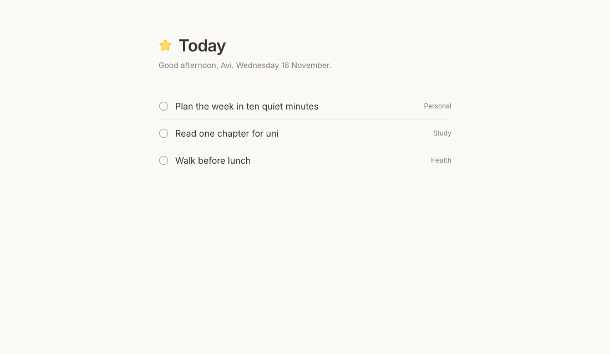
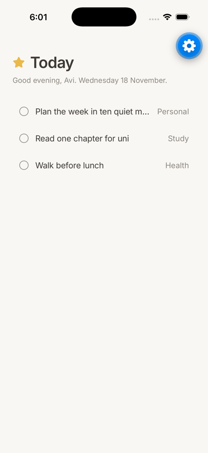

# LifeOS app

A calm place to plan the day. One Convex backend serves a web app, an iPhone app, a Mac app and a remote MCP connector for Claude and Grok.





This repo replaces the old LifeOS ([`mars-s/lifeos`](https://github.com/mars-s/lifeos)). LifeOS is the home of Avi's Tasks. Things 3 feeds it one way until Switch Day, then retires ([`docs/leaving-things.md`](docs/leaving-things.md)). Apple Calendar stays the calendar source.

## Layout

| Path | What it is |
| --- | --- |
| `packages/backend` | Convex schema and functions, the MCP server, and shared helpers. The schema is the single source of types for the whole repo. |
| `apps/web` | Waku 1.0 RC. `ConvexProvider` lives in a `'use client'` component mounted from the root layout. |
| `apps/mobile` | Expo SDK 58 with Expo Router, ExpoKit components and `convex/react`. iPhone first. |
| `apps/desktop` | Tauri 2. Wraps the static web build. |
| `apps/things-sync` | Imports Things 3 into LifeOS, one way, until Switch Day. |
| `docs` | Design notes, starting with the [MCP connector](docs/mcp.md). |

It is a plain pnpm workspace. There is no Turborepo.

## Stack

- TypeScript `strict` everywhere, on TypeScript 6.0 (the version Expo SDK 58 pins).
- `neverthrow` for expected errors. Results cross the server/client boundary as plain `{ ok, value }` or `{ ok, error }` objects, then become `Result`s again on the client. See `packages/backend/shared/result.ts`.
- oxlint with `@interfere/landmines`.
- shadcn/ui on Tailwind 4 for web, with a calm theme: warm off-white backgrounds, soft grey text and low-contrast borders. Tokens live in `apps/web/src/styles.css`.
- [ExpoKit](https://expokit.in) for iPhone UI, with the same calm palette set once in `apps/mobile/src/lib/kit-theme.tsx`.
- Rust follows [BeautifulRust](https://github.com/morganlinton/BeautifulRust), with its strict clippy config.
- Inter and Lucide icons on every surface.

Planned UI libraries, not installed yet. Add each one with the view that needs it:

- [Origin UI](https://originui.com) for richer shadcn-compatible components.
- [Schedule-X](https://schedule-x.dev) with its shadcn theme, for calendar timeboxing.
- [dnd-kit](https://dndkit.com) for drag and drop between lists and onto the calendar.
- [cmdk](https://cmdk.paco.me) for the command palette and quick capture.
- [Motion](https://motion.dev) for small, calm transitions.

## First run

You need Node 22.18 or later, pnpm 10, and Rust for the Mac app.

```sh
pnpm install
```

### 1. Create the Convex deployment (once, needs your browser)

```sh
cd packages/backend
npx convex dev
```

Sign in when it asks, and create a new project called `lifeos-app` on the free tier. Leave it running: it watches `convex/` and regenerates `convex/_generated`. It writes the deployment URL to `packages/backend/.env.local`.

Things 3 fills the app until Switch Day. See "Importing from Things 3" below.

### 2. Point the apps at it

Copy the `.convex.cloud` URL that `npx convex dev` printed.

```sh
echo "WAKU_PUBLIC_CONVEX_URL=https://<deployment>.convex.cloud" > apps/web/.env.local
echo "EXPO_PUBLIC_CONVEX_URL=https://<deployment>.convex.cloud" > apps/mobile/.env.local
```

### 3. Run a surface

```sh
pnpm dev:web       # http://localhost:3000
pnpm dev:mobile    # then press i for the iOS Simulator
pnpm dev:desktop   # starts the web dev server and opens the Mac app
```

## Importing from Things 3

Avi is leaving Things 3. Until Switch Day, LifeOS imports from it one way. Nothing is ever written to Things, and LifeOS wins every conflict. [`docs/leaving-things.md`](docs/leaving-things.md) explains it in plain words.

`apps/things-sync` copies the Things database to a temporary folder, reads the copy with `apps/things-sync/things.sql`, and sends the rows to Convex. The LifeOS Mac app does the same every 5 minutes while it is open.

```sh
pnpm sync:things                # import once
pnpm sync:things -- --dry-run   # count what is in each Things list, send nothing
pnpm sync:things:watch          # import every 5 minutes while the terminal stays open
pnpm things:switch              # Switch Day: one last import, then retire Things
```

It needs two things on the Mac:

- `apps/things-sync/.env.local` with `CONVEX_URL` (see `.env.example`).
- The Things Worker token in your Keychain under `lifeos-app-things-sync`. Convex keeps only its SHA-256 in the `workers` table. To rotate it, store a new token with `security add-generic-password -U -s lifeos-app-things-sync -a "$USER" -w <token>`, then run `npx convex run platform/workers:register '{"name":"things","capabilities":["things"],"tokenHash":"<sha256 of the token>"}'` in `packages/backend`.

macOS may ask once whether your terminal (or LifeOS) may access data from other apps. Say yes.

## Commands

| Command | What it does |
| --- | --- |
| `pnpm check` | oxlint, clippy, typecheck, tests, web build. |
| `pnpm lint` | oxlint with landmines. |
| `pnpm lint:rust` | rustfmt check and clippy with BeautifulRust's lints, warnings as errors. |
| `pnpm typecheck` | `tsc` in each package. |
| `pnpm test` | Backend tests (convex-test) and the Things import CLI tests. |
| `pnpm build` | Static web build into `apps/web/dist/public`. |
| `pnpm build:mobile` | Bundle the iPhone JavaScript with `expo export`. |
| `pnpm build:desktop` | Build `LifeOS.app` with Tauri. |

## Convex codegen

`packages/backend/convex/_generated` is committed, so everything typechecks before you have a deployment. It was generated with Convex's anonymous local mode, which needs no account:

```sh
cd packages/backend
CONVEX_AGENT_MODE=anonymous npx convex dev --once
rm .env.local
```

Once your cloud deployment exists, plain `npx convex dev` regenerates it. Commit the result whenever the schema or a function signature changes.

## MCP connector

The Convex deployment is also a remote MCP server at `https://<deployment>.convex.site/mcp`. Claude Code can connect today with an API key. claude.ai connectors and Grok need a sign-in and consent page first. The [design note](docs/mcp.md) has the steps.

## Agent skills

`.claude/settings.json` enables two Claude Code plugins for this repo:

- pstack, from its official marketplace (`cursor/plugins`). Start multi-file work with `/pstack:poteto-mode`.
- Matt Pocock's skills (`mattpocock-skills@claude-plugins-official`).

`.claude/skills` holds project skills installed with the `skills` CLI (versions pinned in `skills-lock.json`): Vercel's `web-design-guidelines`, `vercel-react-best-practices`, `vercel-composition-patterns`, `vercel-react-native-skills` and `vercel-react-view-transitions`, Anthropic's `webapp-testing` and `mcp-builder`, and BeautifulRust's `rust-best-practices`, `rust-review` and `rust-port`. Update them with `npx skills update -p`.

`.mcp.json` adds the ExpoKit MCP server, so agents can find and add iPhone components. Claude Code asks you to trust the project marketplaces and MCP server the first time you open the repo. `CLAUDE.md` and `AGENTS.md` hold the house rules.

## From the old LifeOS

The old repo stays read-only. Each capability has a migration issue: the MCP server, the Cloudflare Things mirror, the Mac sync companion, the Oura integration, Apple Calendar and Anytype notes. See the [migration issues](https://github.com/mars-s/lifeos-app/issues?q=label%3Amigration).
