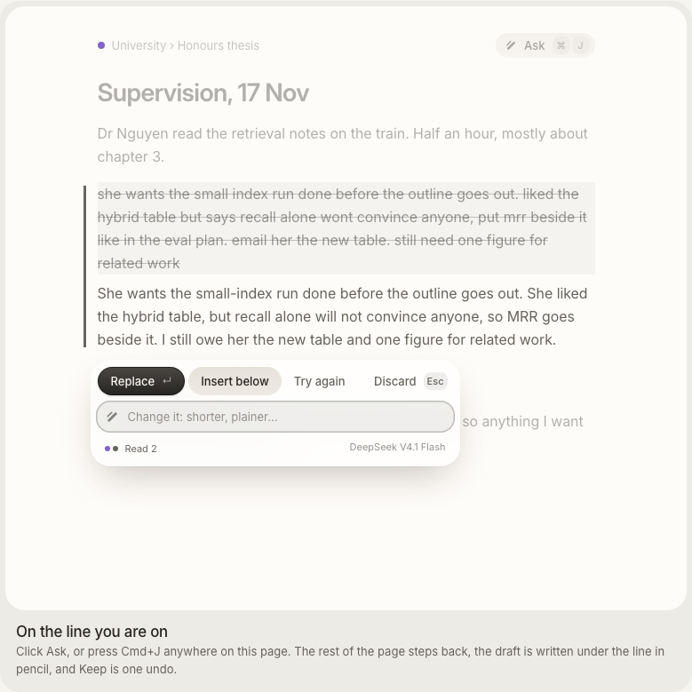
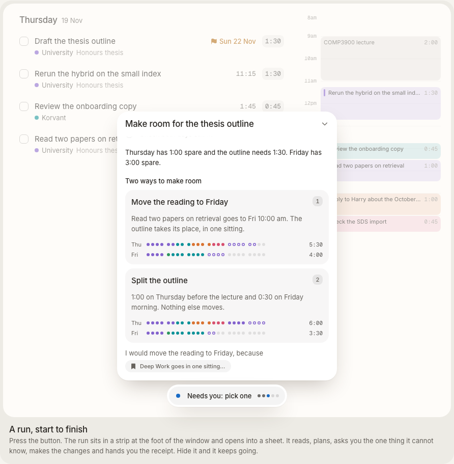

# LifeOS AI design

The design for AI inside LifeOS, for whoever builds it. It is a design only: sample data, no backend. The live specimen is the Waku route `/design/ai` in `apps/web` (run `pnpm dev:web`, open `/design/ai`). Everything on it can be pressed, and Cmd+J works on the page. The shared look is in [system.md](system.md), the Notes look is in [notes.md](notes.md), and the engine behind it is in [the research page](../research/lifeos-ai.md) for issue #83.

## My view: old Notion AI against what came after

1. Avi is right about the gesture. Cmd+J on the line you are on, with the answer under your own words, is still the best way to call AI without opening a chat. Nothing newer beats it for calling.
2. The 2023 answer has aged. It sits in a floating box, so you read it twice: once in the box, once after Replace. Everything it does is a rewrite of text. It never says what it read.
3. What came after is better at the answer. Cursor draws the change where it will land. Granola keeps the AI's words in a different ink until you take them. Linear and Apple put a guess on the field without being asked. Agent tools hand back typed parts and a receipt you can undo.
4. The newest fashion is worse for this goal. Notion AI today, and most apps since, moved to an agent in a side panel. That is a chatbot in a drawer.
5. So the design keeps Notion's gesture, swaps its answer box for pencil on the page, adds unasked pencil on fields, and gives longer work a strip and a receipt. Never a thread.

| Taken | From | Left out |
| --- | --- | --- |
| Cmd+J on the line. A box under the text, never over it. Quick actions first, typing second. Keep, try again, discard, then ask for a change | Notion AI, 2023 (`references/notion-ai/`) | The answer inside the box. The purple sparkle. A menu of twenty actions |
| The change is drawn where it will land, old text struck and new text under it | Cursor's inline edit | Red and green. A diff is a programmer's picture |
| Two inks: yours and the AI's | Granola | Rewriting your notes after the fact without asking |
| A guess that waits on the field it would fill | Linear, Apple Writing Tools, and LifeOS's own Smart Estimate | Shimmer over the text while it thinks |
| Typed parts the app draws, a question before a risky change, a receipt with undo | AffectUI's agent parts (`references/affectui/`), the AI SDK's message parts | Agent avatars, cursors with names, a transcript |
| Actions named by what they do (Tidy, not "Improve writing with AI") | Arc, Raycast | A separate AI window |

Not used: tldraw's computer (a canvas of nodes suits building workflows, not a planner), Mem and Reflect's chat with your notes (it is chat), and Craft's assistant panel (a drawer again).

## Direction

1. **Where you are.** It comes to the line or the Task you are on. There is no chat window, no assistant page and no history to scroll.
2. **Pencil, then ink.** What it suggests under your line is pencil: grey words and dashed edges. Nothing is saved until you keep it, and keeping it is one undo.
3. **It shows its work.** A run you start acts by itself where one undo takes it back. It says what it read, hands you a receipt, and asks first when a change is risky.

AI has no colour of its own. Pencil is graphite, the mark is the thinking orb (`AiOrb` in `components/lifeos/ai-orb.tsx`, from the MIT `thinking-orbs` package at libraries.dev/orbs), and the main button is the silver depth button. The orb is grey ink on a plain canvas, so it follows light and dark by itself and holds a still frame under reduced motion. Its states: idle, done and offline rest on a still dotted ring (offline at 40%), reading is the scanning globe, writing is the moving sash, and needs you is the rolling wave. The package is about 15 KB gzipped, so it is not lazy-loaded. The iPhone port (Skia, from the same geometry in `thinking-orbs/engine`) waits for the iPhone slice. Blue stays what it is in the rest of LifeOS: a link, a selection, or "this needs you". There are no sparkles, no glow and no tinted panels.

### Pencil and ink

| Thing | Pencil (suggested) | Ink (kept) |
| --- | --- | --- |
| Words | `muted-foreground` | `foreground` |
| A Task | Dashed square box, dashed Estimate chip | The real `TaskCheckbox` and chip |
| A link | Dashed underline in ink colour | `brand`, no underline |
| A Work Block | Dashed edge in the Area colour, 6% tint | 16% tint with the Area bar |
| Time on a day meter | Hollow dots (the meter's own `guess` dot) | Filled dots |
| An Estimate | Dashed chip with the AI mark on its corner | The selected chip |
| A linked note | Chip with a dashed edge | Solid chip |

Pencil is never written to the note or the Task. It is drawn over them. That is why discarding costs nothing and keeping is one change.

### How it fits the engine

The research page fixes one engine with two modes. The design draws both.

| | Cmd+J | A run |
| --- | --- | --- |
| Started by | Cmd+J on a line, a selection or a Task | "Do it" on a plan, a Template or a schedule |
| It may | Suggest. Everything is pencil until Enter | Change things by itself, where one undo takes it back |
| It asks first | Always, because nothing is saved until you keep it | Only for the Trash, a Task becoming a Project, more than 10 changes, or anything that cannot be undone |
| You see | The box under the line and pencil on the page | The strip, the sheet, a receipt, and an entry in Activity |

## Screens

Each section has four shots in this folder: `ai-<name>.png`, `-dark`, `-phone` and `-phone-dark`. Desktop is 1440 px wide, phone is 390 px. Five moments have their own shots at desktop width, light and dark. `ai-cmd-j.mp4` is a 15 second recording of Cmd+J in a note.

| Section on the page | Shots | What it shows |
| --- | --- | --- |
| In Notes | `ai-notes`, `ai-notes-ask`, `ai-notes-draft` | Cmd+J on a paragraph, the two inks, the folded box while you keep typing, and the box in four moments |
| In Tasks | `ai-tasks`, `ai-tasks-time` | Cmd+J on an open Task card, a pencil Work Block in the Planner, and guesses that wait on a field |
| The agent at work | `ai-agent` | Thinking, a plan, sources, a decision, three small graphs, asking first, and a receipt |
| A longer run | `ai-run`, `ai-run-decision`, `ai-run-done` | A whole run in the Planner, the strip in five states, and runs in Activity |
| Memory | `ai-memory` | The Memory page, the chips on an answer, and the index |
| iPhone | `ai-iphone` | The ask sheet, the draft bar, the run strip, a decision sheet and the Memory list |





## Cmd+J in Notes

**The lit line.** Cmd+J works on the block with the caret, or on a selection. The rest of the page drops to 35% opacity, the block gets a 4.5% wash and its margin bar turns to ink. Nothing glows and nothing moves. It is a reading lamp, not a spotlight.

**The box.** One box, 416 px wide at most, under the block and never over it. It has no title, no avatar and no history.

| Moment | What is in it | Keys |
| --- | --- | --- |
| Ask | A field ("Ask, or pick below…") and five actions: Turn into Tasks, Link related notes, Summarise, Tidy, Continue. A count from the index shows beside a row when it arrives. The foot says what it will read and which model answers | Type to filter. Up and Down. Enter picks. Esc closes |
| Reading | One line: the mark pulsing and what it is reading | Esc goes back to the list |
| Writing | The same line says Writing. The draft streams onto the page, not into the box | Esc stops and keeps what is there |
| Draft ready | The main button is named for what it does (Replace, Add 3 Tasks, Link 3 notes, Insert). Then Try again and Discard, a field to ask for a change, and what it read as chips | Enter keeps. Esc discards. Type and Enter asks again |
| Offline | It still opens at once. The actions are greyed, and one sentence says AI needs a connection and that writing, Tasks and undo still work | Esc closes |

Free text works too. If nothing in the list matches, the one row is Ask "your words".

**Where each answer lands.**

| Action | Draft | Keep |
| --- | --- | --- |
| Tidy | The old paragraph is struck and fades. The new one is written under it in pencil | Replace folds the old one away and inks the new. Insert below keeps both |
| Turn into Tasks | Pencil Tasks appear under the paragraph, each with a guessed Estimate | They become real Tasks in the note's Project |
| Link related notes | Phrases in your own text get a dashed underline, one by one | They become links. Your words do not change |
| Summarise | One pencil line under the paragraph | Inserted |
| Continue | Pencil words carry on from the end of your sentence | Kept |

**Keep typing.** The box never holds the keyboard hostage. Move the caret and the box folds into one line under the draft (Draft, Cmd+Enter keeps, Cmd+Backspace discards). The draft waits in pencil with a dashed bar in the margin. Typing in the block being drafted stops the draft.

**Undo.** Keeping is one change through `changeMutation`, so it is one Activity entry, one toast and one Cmd+Z, even when it made three Tasks.

## Cmd+J in Tasks

The same key and the same box, on the open Task card. The card stays lit and the list steps back. Each answer lands on the field it would fill.

| Action | Where it lands |
| --- | --- |
| Break into steps | Pencil rows in the Checklist |
| Estimate | A dashed chip in the Estimate row, with one sentence of why |
| Find a time | A dashed Work Block chip under Planned, the day drawn as a track with the gap it found, one sentence of why, and two other times you can press |
| Find related notes | Dashed note chips in a Notes row |
| Draft the email | Pencil text in the Task's notes |

**In the Planner.** Find a time draws a pencil Work Block on the day column and hollow dots on the day meter. Plan it inks both. Another time moves it. A block never slides between times: it fades in at the new place.

**Without asking.** A guess can wait on a field with no Cmd+J at all, the way Smart Estimate does today: a dashed chip with the AI mark on its corner. Press it to keep it. Leave it and nothing happens.

## The agent at work

A run sends back typed parts, not paragraphs. LifeOS draws each one with its own component. All of them take plain props (`Part` in `model.ts`) and are drawn by one `PartView` switch, so the Mac, the web and later the iPhone share them.

| Part | What it is | States | Maps to (AI SDK) |
| --- | --- | --- | --- |
| Thinking | The mark pulses, a line says what it is reading, and a dot joins the row for each thing read, in that Area's colour | Reading, with a count | Tool calls in flight |
| Plan | The steps, written before it starts, on a rail | Not started, doing (a pulsing dot), done (a tick), needs you (blue). A loop is a row of dots filling, with a count | A `data-plan` part |
| Words | One or two plain sentences | | Text |
| Decision | Two honest options side by side, each with what it does to your days as dot meters. One line says which it would pick and why, with the memory it leaned on | Open, picked (the other card goes away and the title becomes "You picked") | A question to Avi, as an approval request |
| Graphs | Time: a day as a track with commitments, Work Blocks and a dashed suggestion. Capacity: `DayMeter` rows with hollow dots for time it would add. Progress: dots done, with hollow dots for this week | | Tool results (`get_day_plan` and friends) |
| Asking first | A dashed panel headed "Nothing has changed yet", one sentence of why it is asking, each change as a row you can untick, then the action and Not now | Asking, declined, done (it becomes the receipt) | `tool-approval-request` |
| Receipt | What was done, in ink, with the time and the model. Undo all, and undo for each change | Made, some undone, all undone | Tool results from `changeMutation` |
| Remembered | One row under the answer: Remembered, the sentence, Undo | Kept, undone | The `remember` tool |
| Sources | Dots and "Looked at 5". Opens into chips for notes, Tasks, days and memories. Each chip opens the thing | Closed, open | Search hits and `read_note` calls |

A part the client does not know falls back to one quiet line, as the research page says.

## A longer run

**The strip.** A run lives in one pill at the foot of the window, where the focus pill lives. It shows the mark, one line of what it is doing, a dot for each step, and one action.

| State | Words | Action |
| --- | --- | --- |
| Working | What it is doing now | Stop |
| Needs you | "Needs you: pick one", with a blue dot | Open |
| Done | "Done. 3 changes", with a green tick | Undo all |
| Offline | "Waiting for a connection", with a hollow dot | None. It carries on when you are back |
| Failed | "Stopped. Nothing changed", with a red dot | Try again |

It makes no sound, shows no badge and never times out. It is the only AI thing that stays on screen, and it goes when the run is done and dismissed.

**The sheet.** Press the strip and the run opens above it, 432 px wide. The title is what you asked for, as a heading, not a bubble. The body is the parts in order. The sheet scrolls to the part that matters: the question while it waits, the receipt when it is done. While it works, one line at the foot lets you tell it something ("keep Friday morning free"). Hide it and the run keeps going.

**Later.** Every run is one entry in Activity, under a Runs filter. From there you can undo the whole run, open its receipt, or pick up one that is waiting for you. This is the research page's Agent Inbox. I put it in Activity because that is already where "what changed and can I undo it" lives.

## Memory

**The page.** Settings, AI, Memory. Each memory is one plain sentence with where it came from ("You said so on 3 Nov", "From 41 finished Tasks") and how often it was used. New ones are on top, then pinned ones, then the rest by kind. Click a sentence to rewrite it in place. Pin one and it is used every time. Forget really deletes it, with the usual undo toast. Forget everything is at the foot. One switch turns memory off, and a line says what that means.

**On the answer.** A new memory shows as a row under the answer that made it, with Undo. A memory that shaped an answer shows as a chip in its sources. Press it to edit it, forget it, or leave it out this once.

**The index.** One list of the six things in the index (Tasks, Projects and Areas, Notes, Saved Links, Days, Memories), each with a count and a bar of 20 dots. Blue dots that pulse are still to come. One line says the notes stay on your devices and that search works with AI off.

## iPhone

There is no Cmd+J on a phone. Select text, or press the AI mark in the bar above the keyboard, and the same list rises as a glass sheet with 48 pt rows. A draft is the same pencil under the same line. One depth button does the main thing (Replace) and the quiet pair sits in glass beside it. A run rides above the tab bar like a track that is playing, and opens into a sheet. The Memory page is a grouped list. The parts are the same data drawn with native type sizes. The specimen draws them at web sizes inside the frame.

## Motion

| Moment | Motion |
| --- | --- |
| Cmd+J from the keyboard | The box is there on the next frame. No animation |
| Ask pressed with the pointer | The box rises 6 px and fades in, 200 ms on `ease-out` |
| The line lights up | The rest of the page fades to 35% over `dur-base`. The bar changes tone over `dur-fast` |
| Reading and Writing | The words morph (`MorphText`). The mark's two strokes pulse 160 ms apart |
| A draft arrives | Each word fades in over 200 ms as it comes, about 45 ms apart. Tasks and links come 260 ms apart. Nothing slides |
| Tidy | The old text is struck and fades to 45% over `dur-base` |
| Keep | Pencil turns to ink over `dur-slow`. A dashed edge turns solid at once. Replace folds the old paragraph with grid rows over `dur-base` |
| Discard | Gone at once |
| A pencil chip is pressed | `scale(0.95)` on pointer down, then ink over `dur-slow` |
| A plan step | The marker fills over `dur-base`. The doing dot pulses. Loop dots fill one by one |
| Thinking | A dot scales in from 0.5 over 220 ms for each thing read |
| A decision is picked | The card presses to 0.985. The other card goes. The title morphs to "You picked" |
| The strip and the sheet | Rise 6 px and fade in when you start a run with the pointer. Each new part does the same once. Hiding is instant |
| A pencil Work Block moves | It fades in at the new time. It never slides |

Reduced motion: the pulses stop and words arrive without the fade. Colour changes stay, because pencil turning to ink carries meaning. Haptics use the names that exist: `complete` when Keep makes a Task, `toggle` for a tick in Asking first. Nothing fires for a keyboard action.

## The bar

- **Within a frame.** The box opens before any network call. Counts and drafts fill in after. A run answers with its strip on the press.
- **Never blocks typing.** The editor is never locked. A draft is drawn over the note, not written into it, so typing and a draft cannot collide.
- **Everything can be undone.** Keep is one undo. A run is one undo, and each change in it has its own. A memory has Undo on its chip and Forget on its page.
- **Offline.** Cmd+J still opens and says in one sentence that AI needs a connection. A run that loses the network waits and carries on. Nothing spins, nothing is lost, and nothing is red.

## Where the code lives

All of it is under `apps/web/src/components/design-board/ai/`. It takes plain props and sample data.

| File | What is in it |
| --- | --- |
| `model.ts` | The shapes: an action (`Verb`), the box as a state machine (`Ask`, `askReducer`: idle, asking, reading, writing, proposed), the agent's parts (`Part`), a run and its reducer, the asking-first reducer, a memory, an index row |
| `sample.ts` | The sample note, Task, run, memories and index, and the functions that turn a run's state into parts |
| `ask.tsx` | `AskBox`, `useAsk` (the timers), and the Cmd+J registry (`useCmdJ`, `useCmdJTarget`) that sends the key to the nearest target |
| `parts.tsx` | `Ink`, `MarginBar`, `StreamWords`, `PencilBox`, `PencilChip`, `SourceChip`, `Sources`, `ModelTag` |
| `graphs.tsx` | `DayTrack`, `LoadRows`, `ProgressDots`, `DayColumn` |
| `agent.tsx` | `Thinking`, `Plan`, `Decision`, `Gate`, `Receipt`, `Remembered`, `GraphView`, and `PartView` |
| `run.tsx` | `RunStrip`, `RunSheet`, and the run specimens |
| `notes.tsx`, `tasks.tsx`, `agent-specimens.tsx`, `memory.tsx`, `phone.tsx`, `board.tsx` | The specimens for each section, and the page |

It reuses `AiOrb`, `TaskCheckbox`, `TaskRow`, `DeadlineMarker`, `DayMeter`, `AreaDot`, `Button`, `IconButton`, `Kbd`, `KeyCombo`, `Segmented`, `Switch`, `MorphText`, the toast stack and `showUndo`, and from the Notes specimen `NOTE_TYPE`, `Caret`, `Fold`, `SearchPill`, the glass recipe and the sample notes.

Three things outside the folder changed: `pages/design/ai.tsx` is the route, `convex-client-provider.tsx` lists `/design/ai` as a public path, and `pages.gen.ts` was regenerated by Waku. The iPhone frame and glass in `phone.tsx` are a copy of the ones in `notes/iphone.tsx`, because that file does not export them and this work was not to touch existing screens. They should move to one shared file when either is built.

### Tokens to add when it is built

No token was added to `styles.css`. These live as classes for now.

| Proposed token | Value | Why |
| --- | --- | --- |
| `pencil` | `muted-foreground` for words, `foreground` at 35% dashed 1.5 px for edges | One name for "suggested, not saved" |
| `lit-wash` | `foreground` at 4.5% | The line Cmd+J is working on |
| `stepped-back` | 35% opacity | Everything else while the box is open |
| `ai-ring` | `foreground` at 50% | The focus ring on AI surfaces is graphite, not blue. Today it is the `AI_RING` class in `parts.tsx`, which sets `--ring` |

### Checking it

`apps/web/scripts/check-ai-design.py` opens the page in light and dark at both widths, fails if the page scrolls sideways or logs an error, takes every shot in this folder, and clicks through Cmd+J in a note (pick, keep, undo, filter, stop, discard), Find a time on a Task, a decision, asking first, a whole run, and Memory. `RECORD=1` also records `ai-cmd-j.mp4` (it needs ffmpeg).

```
BASE=http://localhost:3990 RECORD=1 uv run --with playwright python scripts/check-ai-design.py ../../docs/design
```

## Notes for the build

- **The box is a state machine.** `askReducer` has five states and eight events. The real one adds only where the words come from: `useUIMessages` for the stream, and a `data-proposal` part for the draft.
- **A draft is a decoration, not text.** In CodeMirror the pencil is a widget decoration after the block (or a mark decoration for links). Keep turns it into one transaction. In a Task card it is local state until Keep calls the change.
- **Counts beside a row** come from the index query, which is quick but not instant. The row shows with no count first. Only Estimate and Find a time can be worked out on the device.
- **One PartView.** Map part names to components in one place. Unknown parts fall back to one line.
- **The run strip and the focus pill** share the foot of the window. See question 4.
- **Words.** Buttons are named for what they do. No "AI" in a label except the product name. A failure says what happened to the data first ("Stopped. Nothing changed").

### What changed after reading the research page

Three things in the first pass were wrong against the engine, and were redrawn:

1. A run stopped at a preview before every write. Now a run acts and hands over a receipt, and the preview is the Asking first part, for risky changes only.
2. New memories waited in pencil until Avi said Remember. Now a memory is real when it is written, and shows with Undo.
3. The offline box said linking still worked on the Mac. The index lives in Core, so offline the box says plainly that AI needs a connection.

## Open questions for Avi

1. **Graphite, not blue.** AI has no colour here. Today's Suggested steps panel and Smart Estimate chip are tinted blue with a shimmer band. Should they move to pencil when this is built? I would.
2. **Where pencil ends.** Cmd+J suggests and a run acts, as the research page says. Do you want runs to ask before every change for the first few weeks? It is one setting.
3. **Where runs live.** A Runs filter in Activity (drawn), or an Agent Inbox row in the sidebar?
4. **Two pills.** A Focus Session and a run can both be live. Side by side at the foot, or does the run tuck into the focus pill while you focus?
5. **The lists of actions.** Five in Notes and five on a Task. Are they the right ones, and which should be first?
6. **Several Tasks at once.** Cmd+J on a multi-selection is not drawn. Wanted?
7. **Offline.** The box only says it needs a connection. Do you want "do this when I am back online"?
8. **The model name** sits in the corner of the box, as it does on Suggested steps today. Keep it, or hide it until you hover?
9. **"Not this time"** on a memory chip leaves a memory out of one answer. Useful, or one button too many?
10. **The steer line** in the run sheet is the closest thing to chat in this design. Keep it?
11. **iPhone.** The AI mark sits in the bar above the keyboard, and in the selection menu. Should a long press on a Task open it too?
12. **Memory by default.** The research page has the agent remember, then show Undo. The other choice is to ask before each one. I drew the first, because a question every time is noisier than a chip.
