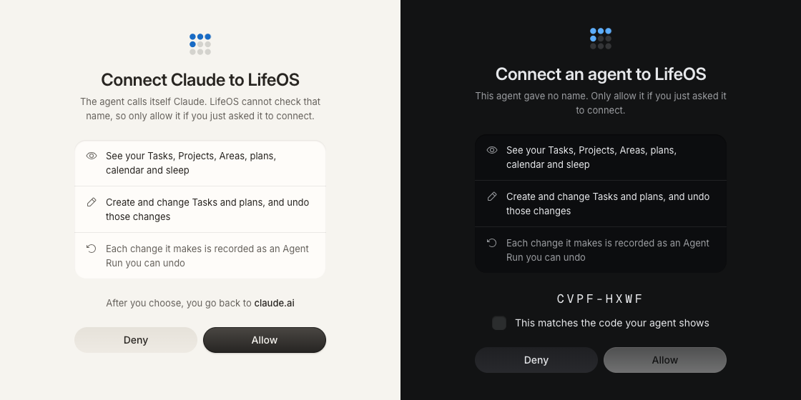

# MCP connector

LifeOS runs its remote MCP server inside the Convex deployment, with the [`@convex-dev/mcp`](https://www.convex.dev/components/mcp) component. There is no separate server and no separate auth provider. Claude Code, claude.ai, ChatGPT and Grok all talk to the same URL:

```
https://curious-pigeon-412.ap-southeast-2.convex.site/mcp
```

## Tools

Each tool reads or writes through the same code as the app. Reads call the app's own owner queries (`readAsOwner` in `platform/effect.ts`). Writes call the app's own change mutations (`changeAs` in `platform/effect.ts`), so every write records Activity and can be undone. Nothing is ever written to Things 3.

Ids come from the read tools. Dates are `YYYY-MM-DD`. Times are in Avi's time zone (the zone of his latest Work Block, else `Australia/Melbourne`) unless a tool is given `timeZone`. Results are small, declared objects (`returns`), so nothing undeclared reaches the agent.

### Read (`lifeos:read`)

| Tool | What it does |
| --- | --- |
| `list_tasks` | One view: `today`, `inbox`, `upcoming` (next `days`, default 14), `anytime`, `someday` or `logbook`. At most `limit` (default 50, max 200), and says how many it left out. The logbook pages with `cursor` |
| `search` | Tasks by words in the title (open only unless `includeClosed`), and Projects and Areas by name |
| `get_task` | One Task in full: notes, Checklist Items with ids, Work Blocks, Actual Time and its repeat |
| `list_areas` | Every open Area with its open Projects, Projects without an Area, and the Label names |
| `get_day_plan` | The Planner for a date: Day Plan Tasks in order, the Goal and the day meter (planned, guessed, working, busy and free minutes), Work Blocks, External Commitments and the Sleep Window either side |
| `list_repeats_and_templates` | Recurrence Rules due in the next `days` with a readable schedule, and every Template |
| `list_smart_blocks` | Smart Blocks on a date and the `days` after it (max 14): window, repeat, filters, and how many Work Blocks fill each |
| `preview_smart_block_fill` | Which Tasks would fill one Smart Block occurrence, with times, size source and a reason each, what stays, what is freed and what was skipped. Writes nothing. `exclude` and `prefer` take Task ids |
| `recent_activity` | Recent changes, newest first, with the actor, the Agent Run, what they touched and whether they were undone. Filter by `runId`, page with `cursor` |

### Write (`lifeos:write`)

| Tool | What it does | App change it runs |
| --- | --- | --- |
| `create_task` | A Task with notes, When, Deadline, Estimate, Labels (by name), Area or Project, and Checklist Items | `tasks.create`, `checklist.add` |
| `update_task` | Any of title, notes, When, Deadline, Estimate, Labels and parent. `null` clears the Deadline or Estimate | `tasks.rename`, `setNotes`, `setWhen`, `setDeadline`, `setEstimate`, `setLabels`, `move` |
| `set_task_status` | `completed`, `open` (reopen or restore) or `trashed` | `tasks.complete`, `uncomplete`, `restore`, `trash` |
| `update_checklist` | Add items, tick and untick items of that Task | `checklist.add`, `checklist.tick` |
| `save_area` | Create an Area, or rename one | `areas.create`, `areas.rename` |
| `save_project` | Create a Project (in an Area or not), or rename and move one | `projects.create`, `rename`, `move` |
| `convert_task_to_project` | Turn a Task into a Project: its Checklist Items become Tasks in it, its Work Blocks, Focus Sessions and links move to the first open new Task, and the Task goes to Trash | `convert.toProject` |
| `set_day_goal` | Set a date's Goal in minutes, or `null` to reset it | `plan.setGoal` |
| `save_work_block` | Add a Work Block for a Task, or move and resize one | `workBlocks.create`, `move`, `resize` |
| `remove_work_block` | Remove one Work Block | `workBlocks.remove` |
| `start_focus` | Start a Focus Session, a Pomodoro when `minutes` is given | `focus.start` |
| `stop_focus` | Stop the running Focus Session | `focus.stop` |
| `set_repeat` | Make a Task repeat, or stop it with `schedule: null` | `recurrence.setRepeat`, `stopRepeat` |
| `create_task_from_template` | A Task from a Template, with its own Checklist Items | `templates.createTask` |
| `create_smart_block` | A Smart Block on a date, `start` and `end` as HH:mm, optional Area, Project and Label filters and a repeat. It starts empty | `smartBlocks.create` |
| `accept_smart_block_fill` | Works out the same fill as the preview and places its Work Blocks inside the block in one change | `smartBlocks.fill` |
| `undo` | Undo one of this connection's changes, one of its runs, or its current run | `platform/undo` |

`When` is written the way the tools read it back: `inbox`, `anytime`, `someday`, `today`, `tomorrow` or a date, with ` evening` for This Evening.

The Smart Block tools refuse while the Smart Blocks Feature is off.

A bad id, date, When or Label name comes back as a tool error that says what to do next, and nothing is written: each write tool runs in one transaction.

### Where the code lives

| File | Holds |
| --- | --- |
| `convex/mcp.ts` | The server, its scopes and instructions, and the consent API the web page calls |
| `convex/planner/agentReads.ts` | The read tools and their result shapes |
| `convex/planner/agentWrites.ts` | The Planner write tools |
| `convex/platform/agentTools.ts` | `recent_activity` and `undo` |
| `convex/platform/agentRuns.ts` | One Agent Run per connection, and the in-app runs of `ai/runs.ts` (connection `run:<jobId>`) |
| `convex/tools.ts` | The one tool registry, shared with the in-app agent through `ai/adapter.ts` |
| `convex/platform/access.ts` | `agentQuery` and `agentMutation`, the guard every tool goes through |
| `convex/mcp.test.ts` | Every tool through real MCP HTTP calls |

A new Module adds its tools in its own `agentReads.ts` or `agentWrites.ts` and spreads them into `tools` in `convex/mcp.ts`.

## Who may call

- Every tool runs an internal function built with `agentQuery` or `agentMutation`. It refuses any connection that is not the owner's (`LIFEOS_OWNER_USER_ID`, default `owner`) with "This LifeOS belongs to someone else."
- Connections are made only by the owner. `getUserId` returns the owner id only for Avi's own Convex Auth session (`platform/access:isOwner`), so nobody else can approve a connection or mint a key.
- **Scopes.** `lifeos:read` sees the read tools only. `lifeos:write` adds the write tools. The component answers a write from a read-only connection with HTTP 403, and `agentMutation` checks the scope again.

## Agent Runs and undo

- Every write is recorded as an **Agent Run**, one per connection. The first write opens it, and every write within 10 minutes of the last joins it. After 10 quiet minutes the next write opens a new run. Two connections (Claude and Grok, or two machines) never share a run.
- The run is a Job of kind `agent`, claimed by the Worker named `mcp`, with the actor `{ kind: "agentRun", jobId }` on each Activity entry. Its name is the connection's name, for example "claude.ai over MCP".
- Every write tool returns `runId` and `activityIds`.
- **The agent undoes its own work** with `undo`: `{ activityId }` for one change, `{ runId }` for a whole run, or `{ currentRun: true }` for everything since the run began. It can never undo Avi's changes or another connection's.
- **Avi undoes an agent's work** with `platform/undo:undo` for one entry, or `platform/undo:undoRun` for the whole run, from his signed-in session. A run written to in the last 10 minutes refuses with `run_active`; it closes on its own after 10 quiet minutes. The app has no Agent Run screen yet, so today the simplest way is to ask the agent to undo its run.
- Undo is refused when a later change touched the same fields, the same as in the app.

## Connect Claude Code (API key)

Run once, in `packages/backend` (it uses the logged-in Convex CLI):

```sh
npx convex run mcp:createApiKeyForUser '{"userId":"owner","name":"Claude Code"}'
```

Copy `apiKey` from the output. It is shown once, so keep it in your password manager. Then:

```sh
claude mcp add --transport http lifeos https://curious-pigeon-412.ap-southeast-2.convex.site/mcp \
  --header "Authorization: Bearer <apiKey>"
```

For a read-only key add `"scopes":["lifeos:read"]` to the JSON.

## Connect claude.ai or ChatGPT (OAuth)

claude.ai and ChatGPT sign in with OAuth. Their servers talk only to the public `convex.site` URL. The consent page is opened in **your** browser, so it does not need to be public: `http://localhost:3000/connect` works, as long as the web app is running on the Mac you connect from. After you approve once, they keep the connection with refresh tokens and never need the page again.

1. On the Mac, run `pnpm dev:web` and leave it running.
2. In claude.ai, open Settings, Connectors, **Add custom connector**. Name it `LifeOS` and paste the URL above. Leave the OAuth client fields empty. In ChatGPT, add the same URL as a connector in its settings.
3. Click **Connect**. A tab opens on `localhost:3000/connect`. Sign in with GitHub if it asks.
4. Check the client name and what it may do, then click **Allow**. You land back in claude.ai, connected.
5. You can stop `pnpm dev:web` now.

The page (`apps/web/src/components/connect-page.tsx`):

- reads `api.mcp.getAuthRequest` and shows the client name, marked as unchecked, and what each scope allows;
- for a device-flow request (an agent that was only given the URL), shows the code and enables **Allow** only after you tick that it matches what the agent shows;
- without `?request=`, asks for the code and finds the request with `api.mcp.findAuthRequest`;
- calls `api.mcp.authorize`, then returns you to the agent;
- is owner-only through the GitHub sign-in (`OwnerGate`), and refuses to render inside a frame.



### Environment

| Variable | Value | Set now |
| --- | --- | --- |
| `SITE_URL` | `http://localhost:3000`. Also where sign-in returns to | Yes |
| `MCP_CONSENT_URL` | Optional. Defaults to `${SITE_URL}/connect` | Not needed |
| `LIFEOS_OWNER_GITHUB_ID` | Avi's GitHub id | Yes |
| `LIFEOS_OWNER_USER_ID` | Optional. Defaults to `owner` | Not needed |

If the web app ever gets a public HTTPS host, set `MCP_CONSENT_URL` to `https://<host>/connect` and add the host to `SITE_URL`. Then connecting works from any device, not only the Mac.

## Grok

If the Grok client can send an `Authorization` header, use an API key as for Claude Code. If it can only take a URL, it uses the device flow: it shows a link and a code, you approve on the consent page with `pnpm dev:web` running, and it gets a one-hour token with no refresh. That means approving again each hour, so prefer an API key for Grok.
